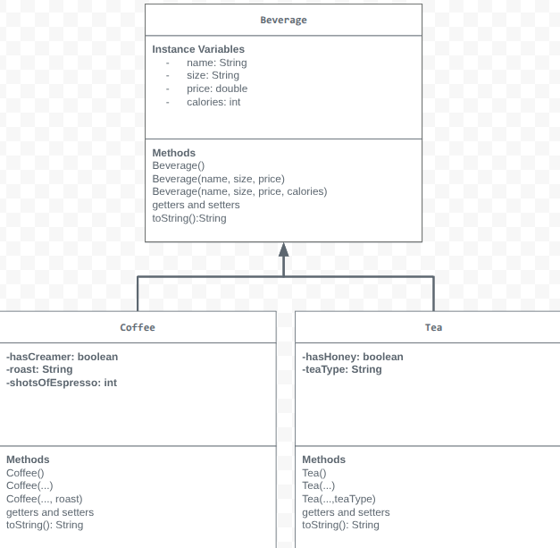

# Unit-2-Store-Management-Project
Beverage Store
# Unit 2 - Store Management Project

## Introduction

You are opening a new business in your community! Businesses often need programs to manage the products and services they offer and track orders and requests from customers. Your goal is to create a store management system for your business.

## Requirements

Use your knowledge of object-oriented programming and class structure and design to create your store management system:
- **Create a class hierarchy** – Develop a superclass that represents a product or service your business offers and one or more subclasses that extend the superclass to represent more specific types of products or services.
- **Declare instance variables** – Declare instance variables in the superclass that are shared with the subclasses and instance variables in the subclasses that are not shared with the superclass.
- **Write constructors** – Write no-argument and parameterized constructors in the superclass and subclasses. Subclass constructors use the super keyword to call the superclass constructor.
- **Implement accessor and mutator methods** – Write accessor and mutator methods for instance variables that should be accessible and/or modifiable from outside of the class.
- **Implement a toString() method** – Write toString() methods in the superclass and subclasses that return information about the state of an object.

## UML Diagram

## Description

1. Write a description of your project here. Include what your store you made, and why you chose this topic. In your description, include as many vocab words from our class to explain how you represented the item/service from your store. If you have user input, explain how the user will interact with your store such as which questions are prompted to the user, what response is your program expecting, and how that is used to output information for your store in the console.

My project is a beverage store that sells drinks like coffee, tea, lemonade, and espresso. I chose this topic because I thought it would be fun to make a store that sells different drinks. I used object-oriented programming to organize my code into classes. Beverage is my superclass, and Coffee and Tea are my subclasses. I used inheritance so the subclasses can get information from the superclass. I made private instance variables to store things like the drink’s name, size, price, and calories. I also used constructors to create objects, getters to get information, and setters to change information. I used toString() methods to print the information about each drink in the console.

2. How is this project related to STEAM (Science, Technology, Engineering, Art, and Mathematics)? Provide explicit examples from the project and details as possible. 

My project connects to STEAM in different ways. Science is included because drinks have different ingredients and calories. Technology is included because I used Code.org and Java to make my program. Engineering is included because I planned my classes and figured out how to make them work together. Art is included because I came up with my own store idea and organized my project. Math is included because I used prices, calories, and the number of espresso shots for my drinks. I also used different data types, like String, int, double, and boolean, to store information.

3. What SLOs did you demonstrate during completing this project?

During this project, I used problem-solving and coding skills to create my beverage store program. I learned how to use classes, objects, inheritance, and encapsulation. I created a superclass and subclasses and added private instance variables to store information. I also made constructors, getters, and setters. I used toString() methods to show the information about each drink. I added comments to explain my code and tested my program by printing different drinks in the console. This project helped me understand how to organize code and how different classes can work together.
